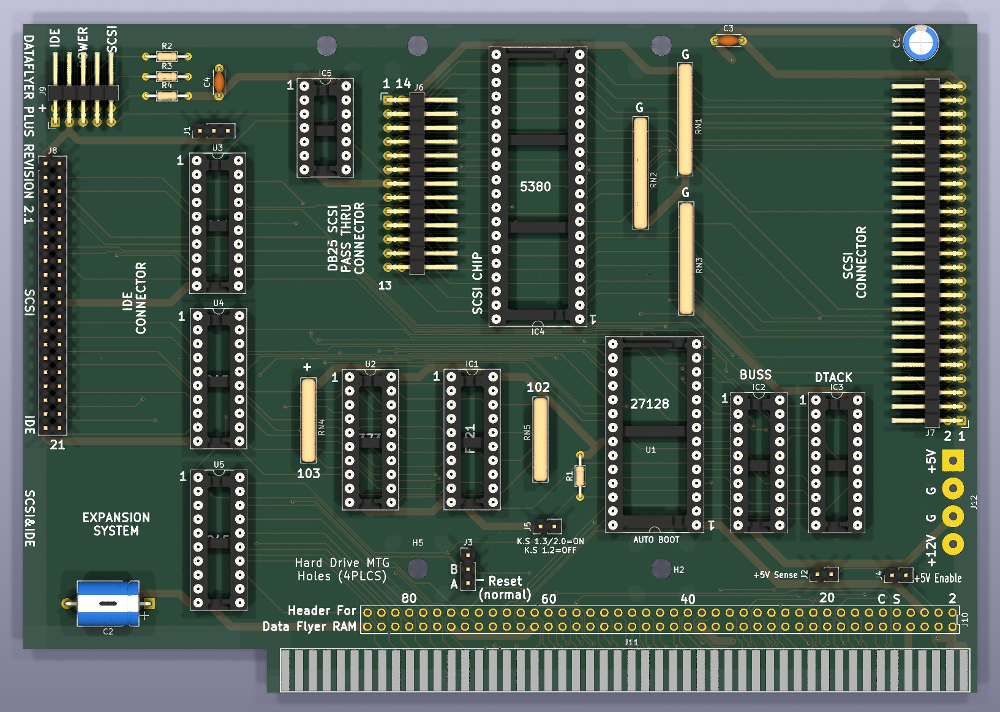
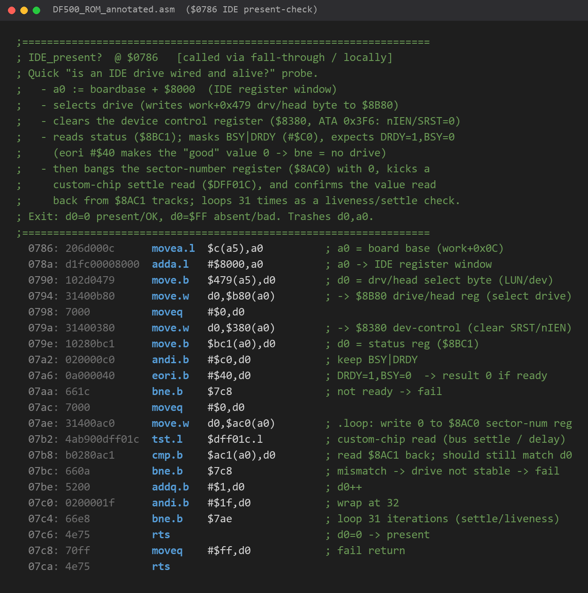
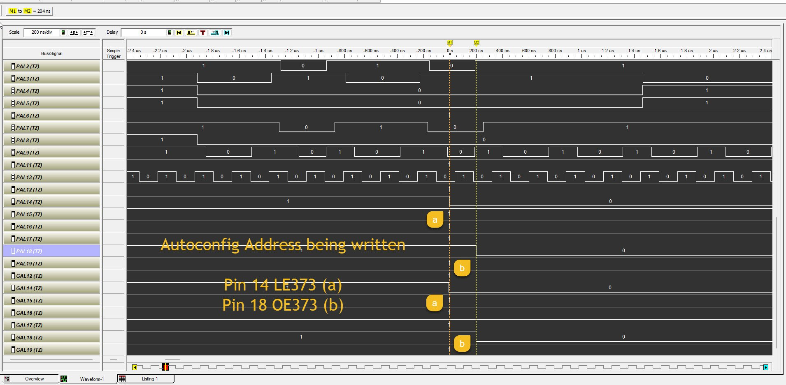
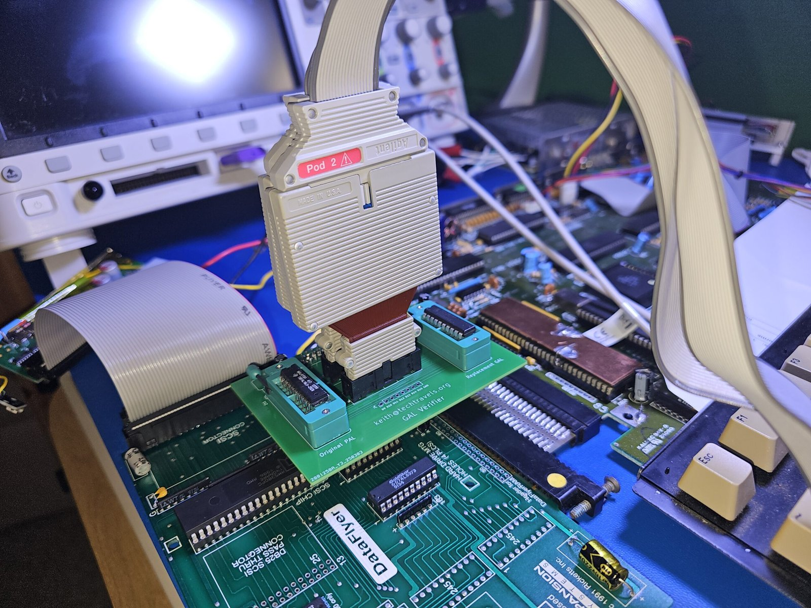
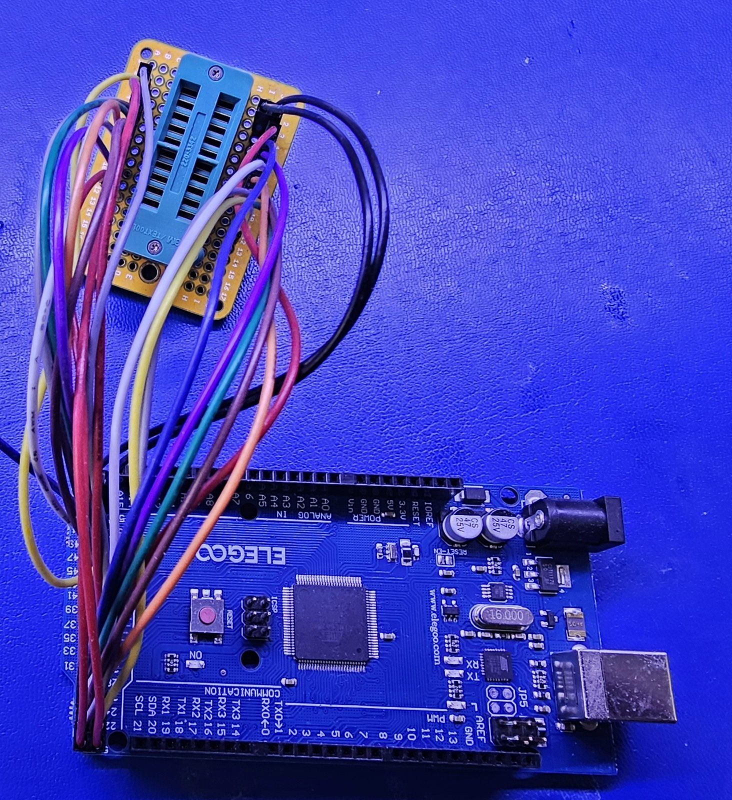
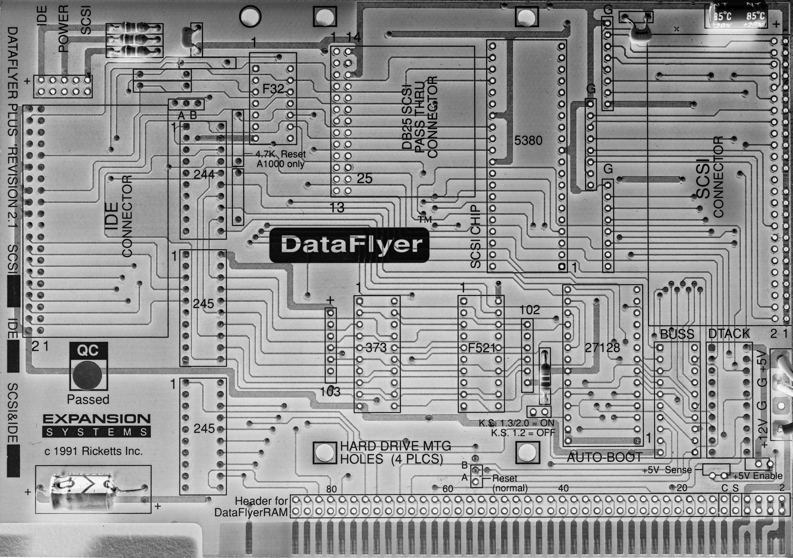
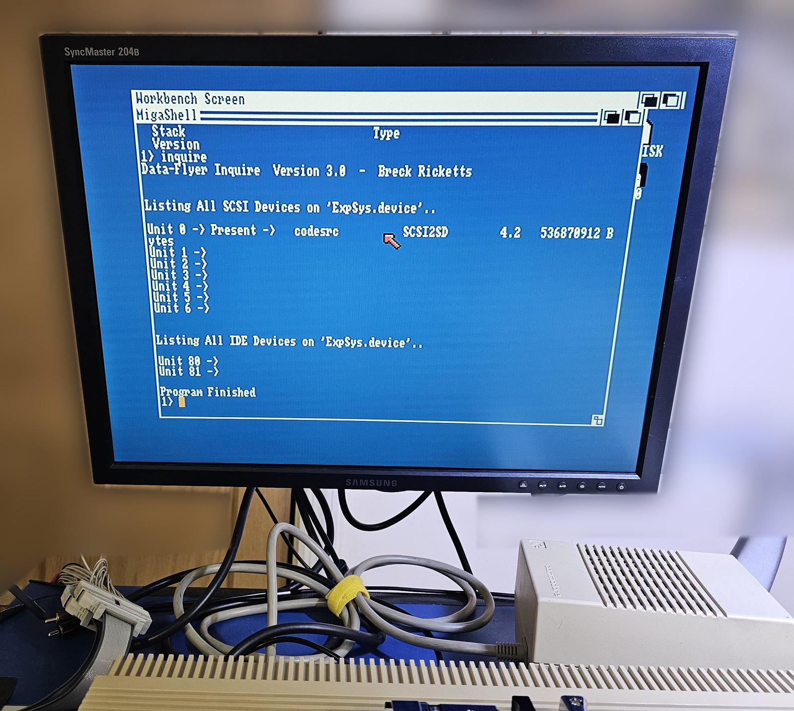

# DataFlyer 500 PAL equations

GAL16V8 replacements for the original PAL16L8 chips on the Expansion Systems
DataFlyer 500, the Amiga 500 side-expansion SCSI/IDE hard disk controller.

The original chips are security-locked TIBPAL16L8-25CN parts and cannot be
read. Their sequential designs (feedback latches) defeat brute-force dumping.
These equations were recovered by black-box characterization of original
chips on a microcontroller test harness, then verified against the original
silicon over hundreds of thousands of test vectors before being burned and
booted in real cards.

**Looking for a file?** Jump to [Pick the right file for your board](#pick-the-right-file-for-your-board).

## How these were made

Each of these files is the end of years of work on real hardware. With the
chips unreadable, every equation had to be earned from the outside.

### 1. Trying to read the chips

I sent original PALs to [Rhine Labs](https://www.stevenrhine.com/) in
Washington state, a professional device-programming lab, where they were
tried on a Xeltek SuperPro 6100N and a BP Microsystems BPM-1610. Neither
industrial programmer could read them: the security fuses are blown, so no
fuse map was ever available. Thanks again, Steven!

### 2. Desoldering and photographing the board

I desoldered every component from a rev 2.1 board and photographed both
sides of the bare PCB at high resolution, so every trace and via could be
followed without parts in the way.

### 3. Recreating the board in KiCad

From those photographs I recreated the entire board in KiCad: a two-sheet
schematic and a full PCB layout, with all 40 parts placed and every trace on
both copper layers redrawn. The resulting netlist became the reference for
every pin-level question, such as which PAL pin drives which AM5380 or IDE
pin and which signals each PAL can see at all. It also showed rev 2.1
routing BUSS pins 15 and 19 the opposite way from Walter's rev 2.0 tracing.
Questionable nets were checked with a meter on real boards, which is how
rev 2.1 and rev 2.3 boards were found to wire DTACK02 pin 13 differently.

<p align="center">
  <br>
  <sub><i>A 3D render of the KiCad recreation of the rev 2.1 board, silkscreen included. The BUSS (IC2) and DTACK (IC3) sockets are at the lower right.</i></sub>
</p>

### 4. Boot ROM disassembly and analysis

I dumped the 27C256 autoboot EPROM, decoded its nibble-wide encoding, and
disassembled and annotated the entire Caprion boot ROM: the AutoConfig
diagnostic area, the IDE and SCSI probe routines, and two independent boot
paths, one of them a proprietary loader that pulls a boot program straight
off the drive instead of using the standard Amiga RDB. Every register access
in the ROM became part of the specification for what the PALs must decode.

<p align="center">
  <br>
  <sub><i>The IDE present-check at $0786 in the annotated ROM: select the drive, check its status, then run a 31-pass liveness loop before declaring a drive present.</i></sub>
</p>

### 5. Driver and boot disk analysis

I unpacked the original install floppies and disassembled the driver stack
and the on-disk boot code (`Autoboot.code`), mapping how `expsys.device`
loads its IDE and SCSI back ends and how the drive's boot partition gets
mounted. I also compared the card against the DataFlyer model in the WinUAE
emulator source.

### 6. Logic analyzer traces of the live system

I captured the card booting in an Amiga 500, sampled as fine as 2 ns, and
correlated the bus cycles against the annotated ROM so each transaction
could be tied to the code that issued it. That is how a failed drive probe
was traced to the exact ROM routine behind it.

<p align="center">
  <br>
  <sub><i>The AutoConfig base-address write, captured live with the original PAL (PAL rows) and a candidate GAL (GAL rows) on the same bus. LE373 (pin 14, a) asserts on the write and OE373 (pin 18, b) follows about 200 ns later, in both chips.</i></sub>
</p>

### 7. A GAL verifier PCB

I designed a board with two ZIF sockets that plugs into the card: one socket
drives the system, while the second sees the same live inputs with its
outputs routed only to a logic analyzer header. A candidate GAL and the
original could run side by side against reality.

<p align="center">
  <br>
  <sub><i>The GAL verifier on a DataFlyer 500 inside an Amiga 500: original PAL in the left socket, replacement GAL in the right, logic analyzer pod on the shared header.</i></sub>
</p>

### 8. Correlation analysis in Python and pandas

Across millions of captured samples, I built and tested a theory for every
output pin.

### 9. A microcontroller platform for interrogating the chip directly

I wired an Arduino Mega 2560 to a ZIF socket and wrote the firmware and host
software to drive every input and record every output. It runs exhaustive
sweeps in every latch state and differential transition campaigns of more
than 200,000 vectors per chip.

<p align="center">
  <br>
  <sub><i>The bench harness: an Arduino Mega 2560 (Elegoo) wired to a 20-pin ZIF socket.</i></sub>
</p>

### 10. AI-assisted analysis

Working with Claude Code, I built fuse-level JED simulators that replay the
bench captures, fitted the models, and ran the differential campaigns that
exposed two behaviors no sweep or dumper had found: a hidden self-hold on
the BUSS chip's /DACK output, and an undocumented eighth output on DTACK02
pin 13.

### 11. Massive amounts of trial and error on a live system

Dozens of GAL images were burned and booted in the card. Several matched the
original on every captured trace and still failed to find the drive, until
the pin 13 discovery explained why.

## Pick the right file for your board

The DataFlyer 500 exists in several PCB revisions and population variants,
and the same socket carries **different programs** on different boards.
Check the PCB revision on your board's silkscreen and the label on the chip
you are replacing.

| Board | Socket (original chip label) | Files |
|---|---|---|
| SCSI-only, PCB&nbsp;rev&nbsp;2.0 | BUSS | [`df500_buss_board_rev20.pld`](equations/scsi_board_rev2.0/df500_buss_board_rev20.pld)<br>[`df500_buss_board_rev20.jed`](equations/scsi_board_rev2.0/df500_buss_board_rev20.jed) |
| SCSI-only, PCB&nbsp;rev&nbsp;2.1 | BUSS | [`df500_buss_board_rev21.pld`](equations/scsi_board_rev2.1/df500_buss_board_rev21.pld)<br>[`df500_buss_board_rev21.jed`](equations/scsi_board_rev2.1/df500_buss_board_rev21.jed) |
| IDE-only, PCB&nbsp;rev&nbsp;2.3 | BUSS socket, chip labeled DFI | [`df500_dfi_board_rev23.pld`](equations/ide_board_rev2.3/df500_dfi_board_rev23.pld)<br>[`df500_dfi_board_rev23.jed`](equations/ide_board_rev2.3/df500_dfi_board_rev23.jed) |
| IDE-only, PCB&nbsp;rev&nbsp;2.3 | DTACK02 | [`df500_dtack02_board_rev23.pld`](equations/ide_board_rev2.3/df500_dtack02_board_rev23.pld)<br>[`df500_dtack02_board_rev23.jed`](equations/ide_board_rev2.3/df500_dtack02_board_rev23.jed) |
| SCSI&nbsp;+&nbsp;IDE combined | either | not available (see below) |

Rev 2.0 and rev 2.1 SCSI boards route two BUSS outputs differently: on rev
2.0, pin 15 drives the AM5380 /CS and pin 19 drives /IOR; on rev 2.1 it is
the reverse. The two BUSS images contain the same logic with those two pins
exchanged. A chip programmed for the wrong revision leaves the SCSI bus
silent.

<p align="center">
  <br>
  <sub><i>A bare rev 2.1 board, scanned after desoldering every component. The revision is printed along the left edge ("DATAFLYER PLUS REVISION 2.1"), above the SCSI / IDE / SCSI&amp;IDE variant boxes. The BUSS and DTACK sockets are at the lower right, next to the AUTO BOOT EPROM.</i></sub>
</p>

On the rev 2.1 SCSI-only board examined, the DTACK02 socket is unpopulated,
so that board needs only the BUSS chip.

The DTACK02 image drives pin 13 (a /DACK window line to the DFI chip on rev
2.3 copper). Do not install it on a board with a different layout.

## What chip to program

All `.jed` files target the **GAL16V8** (20-pin DIP, 2194-fuse JEDEC map,
complex mode). A GAL16V8 is a pin-compatible drop-in for the PAL16L8 socket.

- Tested in cards: GAL16V8D (BUSS, rev 2.0, Walter's board), GAL16V8-15
  (BUSS, rev 2.1), and GAL16V8 parts for the DFI and DTACK02 (rev 2.3, the
  DTACK02 a -25). The original parts are TIBPAL16L8-25, so use -25 or
  faster.
- Atmel/Microchip ATF16V8B uses the same fuse map and most programmers
  accept GAL16V8 JED files for it, but it has not been tested in these cards.
- These files cannot program an original PAL16L8. That is a bipolar,
  one-time-programmable part with a different fuse map.

Programmers such as the TL866 / T48 load the `.jed` directly. Select the
GAL16V8 device that matches the part in your hand.

### Fuse checksums

| File | Checksum |
|---|---|
| [`df500_buss_board_rev20.jed`](equations/scsi_board_rev2.0/df500_buss_board_rev20.jed) (SCSI rev 2.0) | C45CF |
| [`df500_buss_board_rev21.jed`](equations/scsi_board_rev2.1/df500_buss_board_rev21.jed) (SCSI rev 2.1) | C45CF |
| [`df500_dfi_board_rev23.jed`](equations/ide_board_rev2.3/df500_dfi_board_rev23.jed) (IDE rev 2.3) | C4E96 |
| [`df500_dtack02_board_rev23.jed`](equations/ide_board_rev2.3/df500_dtack02_board_rev23.jed) (IDE rev 2.3) | C6A56 |

The two BUSS images share a checksum. Exchanging two output blocks does not
change the fuse sum, so a programmer cannot tell these two chips apart.
**Label the chip** with the board revision after burning.

## Verification status

- **BUSS, SCSI rev 2.0**: the same logic as the rev 2.1 image with pins 15
  and 19 exchanged. Fuse-identical to the source that boots a rev 2.0 board
  (Walter's hardware test, see Credits) when both are compiled with the same
  toolchain. Simulated against the rev 2.1 original's recorded behavior
  (219,073 rows) with zero mismatches. I do not own a rev 2.0 board.
- **BUSS, SCSI rev 2.1**: matched the original PAL on every row of an
  exhaustive 6,144-row sweep and a ~213,000-vector differential campaign.
  Burned GAL boots in the card.
- **DFI, IDE rev 2.3**: matched the original on an exhaustive sweep and a
  212,889-row differential campaign. Burned GAL booted the card on its
  first power-on.
- **DTACK02, IDE rev 2.3**: matched the original on the recorded
  differential streams, including the pin 13 output (the only differences
  were harness transients that cannot occur on the bus). Boots reliably
  across dozens of cold starts. Together with the DFI GAL, an IDE board runs
  with no original PALs at all.

The combined SCSI + IDE board carries a third BUSS-socket program (original
chip label "DFSI"). No specimen has been available, so it is not covered here.

<p align="center">
  <br>
  <sub><i>Data-Flyer Inquire on the SCSI card in January 2025, with an earlier GAL version of the BUSS chip installed, finding a SCSI2SD on unit 0.</i></sub>
</p>

## Rebuilding from source

The `.pld` files are CUPL source. With WinCUPL 5.0a:

```
cupl -m1 -j -a -x -f df500_buss_board_rev20.pld
```

The resulting `.jed` should reproduce the checksums above.

## Credits

Equations reverse-engineered by Keith Monahan (techtravels.org).

Rev 2.0 board pin mapping traced and verified in hardware by
Walter [SURNAME PENDING].

## License

MIT. See [LICENSE](LICENSE).
